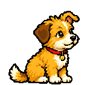

<div align="center">

<h1> Dost</h1>

**A pixel-art dog that lives on your taskbar and barks when your AI agents need you.**

Windows · macOS · single ~6 MB file · no account, no telemetry

</div>

*Dost* means "friend" in Turkish. It walks on your taskbar (or the Dock), and when something needs
your attention it barks and shows a speech bubble. Drag it around, click it to pet it, click the
bubble to dismiss it.

## Install

- **Windows**: download `dost.exe` from [Releases](https://github.com/rytsh/dost/releases) and run it.
- **macOS**: download `Dost.dmg` from [Releases](https://github.com/rytsh/dost/releases) and drag it
  into Applications. It is not notarized yet, so open it the first time with right click → *Open*.

## OpenCode

Bark when OpenCode asks a question or needs permission (answer it from the bubble), show progress of long tasks, and tell when they finish or fail:

```sh
opencode plugin add 'github:rytsh/dost::path:integrations/opencode'
```

Details in the [plugin's README](integrations/opencode/README.md).

## Claude Code and Codex

Permission requests show **Allow / Always / Deny** in the dog's bubble and the click answers the
agent; the dog also barks when it waits for you or finishes its turn. Add to
`~/.claude/settings.json`:

```json
{
  "hooks": {
    "PermissionRequest": [{ "hooks": [{ "type": "command", "command": "dost hook claude", "timeout": 600 }] }],
    "Notification": [{ "matcher": "idle_prompt|elicitation_dialog", "hooks": [{ "type": "command", "command": "dost hook claude" }] }],
    "Stop": [{ "hooks": [{ "type": "command", "command": "dost hook claude" }] }]
  }
}
```

Codex (`~/.codex/config.toml`): `notify = ["dost", "hook", "codex"]`, and for permission buttons
`~/.codex/hooks.json`:
`{ "hooks": { "PermissionRequest": [{ "hooks": [{ "type": "command", "command": "dost hook codex", "timeout": 600 }] }] } }`

`dost` must be on your `PATH` (on macOS: `ln -s /Applications/Dost.app/Contents/MacOS/dost /usr/local/bin/dost`).

## Command line

The same `dost` binary talks to the running dog:

```sh
dost run cargo build --release      # runs it, then barks: done or failed, and how long it took
make test; DOST_STATUS=$? dost done "Tests"
dost notify "Deploy finished" "api is live" --url https://example.com
dost ask "Deploy to prod?" --choices Yes,No   # prints the answer
dost remind 15:00 "Join the call"
```

`dost help` lists everything.

## MCP

Dost serves MCP at `http://127.0.0.1:7777/mcp` (local only), so any AI assistant can use it:

```jsonc
// Claude Code, Cursor, ...
{ "mcpServers": { "dost": { "type": "http", "url": "http://127.0.0.1:7777/mcp" } } }

// OpenCode (opencode.json)
{ "mcp": { "dost": { "type": "remote", "url": "http://127.0.0.1:7777/mcp" } } }
```

Then ask things like *"tell me when localhost:3000 is up"*, *"bark when the build finishes"* or
*"remind me at 15:00 to join the call"*.

| Tool | What the dog does |
| --- | --- |
| `notify` | Barks and shows a bubble. Optional `url` (opened on click), `copy` (put on the clipboard), `source` (who sent it), `mood` (`good`: the dog is happy, `bad`: it is sad and howls; guessed from the words when left out). |
| `ask` · `dismiss` | Shows a question with up to 4 answer buttons and waits for your click; the agent gets the answer. `dismiss` withdraws it. |
| `progress` | A progress bar for a long task, updated in place; the dog is happy when it finishes, barks if it fails. |
| `remind` | Barks later: after some minutes or at a local time. |
| `add_watch` | Checks something every few seconds and barks when it changes: a `url`, a `port`, a `file` (or text in it), a process (`pid`), a GitHub Actions run (`github`: `owner/repo` or a run URL; set `GITHUB_TOKEN` for private repos), or a shell `command`. |
| `react` | Happy, sad, bark, fetch (throws the bone), sleep, wake or zoomies. |
| `copy` | Puts text on the clipboard and says so. |
| `status` · `history` | What the dog is doing, how long you have been idle, and what you may have missed. |
| `check_now` · `list_watches` · `remove_watch` | Manage watches and reminders. |

**Quiet** (settings → Sound): *Night* is 22:00–08:00, *On* until you turn it off. It is also quiet
while an app is full screen (a video, a presentation), unless you turn that off. While quiet the dog
does not bark and only shows questions, progress and sticky messages; the rest goes to *History*.

> [!WARNING]
> Watches can run shell commands on your computer. Only connect clients you trust.

## Make it yours

Settings → **Look**:

- **Name**: click it and type. The name shows in the panel and is told to AI assistants over MCP,
  so you can say *"tell Karabaş when the build is done"*. The dog's birthday is the day you first
  started it; on that day it wears a party hat.
- **Fur** and **collar** colours, and what it **wears**: a bandana, a beanie or sunglasses.
- **Holiday outfits**: a witch hat (and a pumpkin instead of the bone) 24–31 October, a Santa hat
  20 December – 1 January.
- **Bubble**: Classic, Dark, Sky or Mint. Each `source` gets a colour of its own; pick one with
  `"source_colors": { "ci": "#2f6fc4" }` in `settings.json`.

**Fetch**: a bone lies next to the dog. Drag it and fling it; the dog runs after it and brings it
back (just picking it up and letting go moves it without a game). Now and then the dog plays with
it by itself. **Bone** in the panel (or `dost react fetch`) throws it for you; turn it off with
*Bone to play with* (settings → Walk).

**Moods**: good news (tests passed, done) makes the dog happy, failures make it sad. With *Happy,
sad and asking voices* on (settings → Sound) it also sounds different: a double yip, a little howl,
a short "wuf?" for questions.

**Your own bark**: list 16-bit PCM WAV files in `settings.json`; one is picked at random each time:
`"bark_files": ["~/sounds/woof1.wav", "~/sounds/woof2.wav"]`.

## Settings

Click the tray (menu bar) icon for settings: size, walking, sound and quiet hours, recent
notifications, MCP and start at login. Settings are saved to `%APPDATA%\dost\settings.json` (Windows) or
`~/.config/dost/settings.json` (macOS).

**Hide** sends the dog off the right edge of the screen. While it is away, questions, progress and
sticky messages still pop up in a bubble next to the tray icon; other notifications bark, go to
*History* and put a red mark on the icon. **Show** brings it back.

**Sleep** puts the dog to sleep: it stops barking and only questions, progress and sticky messages
are shown; the rest goes quietly to *History*. It works while hidden too. Click the dog or **Wake**
to wake it up.

Hidden and asleep are remembered: the dog starts the same way next time, and so is *History*.

**Keyboard**: while a bubble is up, <kbd>⌥⌘↩</kbd> (Windows: <kbd>Ctrl+Alt+Enter</kbd>) picks the
first answer or closes it, <kbd>⌥⌘1</kbd>–<kbd>4</kbd> pick an answer, <kbd>⌥⌘⌫</kbd> the last one
("no"), and <kbd>⌥⌘L</kbd> means *Later*: the bubble comes back in 10 minutes (also a link in the
bubble).

When you come back after 5 minutes away, a single bubble sums up what happened meanwhile. If the
screen was locked, important news also shows up as a system notification when you unlock.

Dost updates itself from GitHub Releases (settings → Connect → *Update automatically*); click the
version at the bottom of the settings to check now. See [packaging/README.md](packaging/README.md).

## Build

Requires [Rust](https://rustup.rs) 1.88+.

```sh
cargo build --release   # Windows or macOS
make app                # macOS app bundle
make build-windows      # Windows from WSL/Linux (needs cargo-xwin)
```

`make help` lists the rest. How the art was made: [art/README.md](art/README.md). The app icon (a
paw) is drawn by `examples/icon.rs`; `make icons` rebuilds `AppIcon.icns` and `dost.ico`, and
`build.rs` puts the icon into `dost.exe`.

## License

[MIT](LICENSE)
